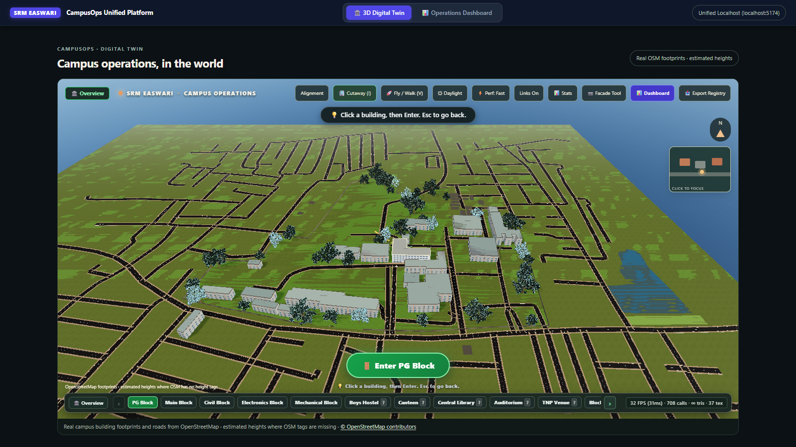
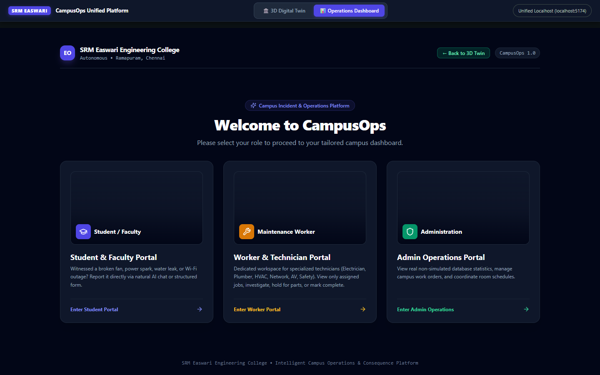

<p align="center">
  
</p>

<h1 align="center">🏫 CampusOps Digital Twin</h1>

<p align="center">
  A navigable 3D campus scene built from real OpenStreetMap data, fused with an AI-powered<br/>
  operations dashboard for SRM Easwari Engineering College.
</p>

<p align="center">
  <a href="https://react.dev"></a>
  <a href="https://threejs.org"></a>
  <a href="https://www.typescriptlang.org"></a>
  <a href="https://fastapi.tiangolo.com"></a>
  <a href="https://vitejs.dev"></a>
  
</p>

---

## What Is This?

**CampusOps** is a full-stack campus management platform with two layers that run as one:

| Layer | What it does |
|---|---|
| **3D Digital Twin** | Navigable real-time 3D scene of SRM Easwari — built from real OpenStreetMap footprints. Click any building → exploded cutaway → click a room → walk-through diorama interior |
| **Operations Dashboard** | Role-based complaint and work-order system (Student → Worker → Admin) with an AI intake assistant that understands free-text, extracts location, and routes tickets automatically |

Both layers run from **one command on one port** — no switching tabs.

---

## Screenshots

### 3D Campus View — Real OSM Footprints, Broadleaf Trees, 144 FPS


### Building Cutaway — Exploded Floor Layers


### Room Diorama + Projector Failure Predictor


### Operations Dashboard — Role Selection



---

## Architecture

```
┌────────────────────────────────────────────────────────┐
│                 localhost:5174  (Unified)               │
│                                                        │
│   ┌──────────────────┐   bridge   ┌──────────────────┐ │
│   │  3D Twin (R3F)   │◄──────────►│ Ops Dashboard    │ │
│   │                  │            │                  │ │
│   │  • OSM geodata   │            │  • Student portal│ │
│   │  • PBR rendering │            │  • Worker portal │ │
│   │  • Projector FSM │            │  • Admin portal  │ │
│   │  • Campus nav    │            │  • AI intake     │ │
│   └────────┬─────────┘            └────────┬─────────┘ │
│            │      dashboardBridge.ts        │           │
│            └──────────────┬────────────────┘           │
│                           ▼                            │
│          Vite mock API (no backend needed for demo)    │
│          FastAPI + PostgreSQL (optional, via Docker)   │
└────────────────────────────────────────────────────────┘
```

**Navigation flow:**
```
Campus View  →  Click building  →  Cutaway (exploded floors)
                                       ↓
                              Click room pill
                                       ↓
                             Room Diorama (3D interior)
                                       ↓
                        [Dashboard button] → Ops Dashboard
                        [← Back to 3D Twin] → back
```

---

## Features

### 🌐 3D Digital Twin
- Real building footprints and roads from **OpenStreetMap** (SRM Easwari, Ramapuram, Chennai)
- OSM height tags used where available; estimated heights elsewhere
- Navigable: **Campus → Cutaway → Room Diorama**
- Procedural **broadleaf shade trees** via `@dgreenheck/ez-tree` — bark texture, 5–7 foliage clusters, per-tree random tint
- **PBR materials**, ACES filmic tone mapping, N8AO ambient occlusion, bloom, vignette
- **144 FPS** on campus view (instanced meshes, LOD-aware tree placement)

### 🤖 AI Complaint Intake
- Student submits a complaint in plain text: *"The fan is making noise in the lab"*
- AI extracts: **category** (Electrical) + **location** (block + room)
- If location missing → AI asks a **targeted clarification question**
- Student replies → structured work order created and **routed to the right technician**

### 🏢 Operations Dashboard
- **Student Portal** — submit complaints via AI chat or structured form, track ticket status live
- **Worker Portal** — see only your assigned work orders, mark tasks complete
- **Admin Portal** — full work order overview, approve/reject, audit trail
- **Real-time sync** — completing a task updates all portals within 3 seconds

### 🔮 Projector Failure Predictor
- Deterministic **finite-state machine** (`projectorSim.ts`) models projector health per room
- Tracks: lamp hours, filter cycles, thermal state, PJLink sensor data
- Predicts **failure date with high/low confidence** — work orders pre-generated before failure occurs
- Scrubble 30-day simulation timeline inside the room diorama panel

### 🔗 Cyber-Physical Bridge
- `dashboardBridge.ts` polls work orders every 5 seconds
- **At-risk rooms get a live 3D marker** overlaid on the campus scene
- Clicking the marker opens the work order in the dashboard

---

## Quick Start

```bash
# Clone
git clone https://github.com/developerHarish2007/campus-twin-ops.git
cd campus-twin-ops

# Install dependencies
npm install
npm install --prefix dashboard/frontend

# Copy env
cp .env.example .env.local

# Run everything — single command, single port
npm run dev
```

Open **[http://localhost:5174](http://localhost:5174)** — the 3D twin loads immediately. Click **Operations Dashboard** in the top bar to switch to the dashboard.

> **No backend needed** — the demo runs fully on a Vite-embedded mock API. All portals (Student, Worker, Admin), AI intake, real-time sync, and work order routing work without Docker.

### With the Real Backend (optional)

```bash
# Start PostgreSQL
docker compose -f dashboard/docker-compose.yml up -d postgres

# Seed the database
python dashboard/scripts/setup_db.py
python dashboard/scripts/seed_demo.py

# Disable mock mode
# In .env.local: VITE_MOCK_MODE=false
npm run dev
```

---

## Tech Stack

| Layer | Technology |
|---|---|
| 3D Rendering | Three.js 0.186, React Three Fiber 9, Drei 10 |
| Postprocessing | ACES filmic tone mapping, N8AO, Bloom, Vignette |
| Procedural Trees | `@dgreenheck/ez-tree` 1.1 |
| Geodata | OpenStreetMap (ODbL), locally packaged JSON |
| Twin Frontend | React 19, TypeScript 7, Vite 8 |
| Dashboard UI | React 18, Tailwind CSS 3, Lucide React |
| Backend | FastAPI 0.115, PostgreSQL 16, pgvector |
| DB Constraints | 6 PostgreSQL-level FSM + inventory + audit invariants |
| State | Zustand, React Context |
| Build | Vite 8, Rolldown, TypeScript 7 |

---

## Project Structure

```
campus-twin-ops/
├── src/                        # 3D Twin (React + Three.js)
│   ├── views/CampusWorld.tsx   # Main 3D scene
│   ├── views/CampusMap.tsx     # 2D fallback map
│   ├── views/RoomInterior.tsx  # Room diorama
│   ├── sim/projectorSim.ts     # Projector FSM predictor
│   ├── services/dashboardBridge.ts  # Cyber-physical bridge
│   └── data/roomMapping.json   # Room registry
├── dashboard/
│   ├── frontend/               # Operations Dashboard (React + Tailwind)
│   │   └── src/views/          # Student / Worker / Admin portals
│   ├── backend/                # FastAPI + PostgreSQL (Docker)
│   └── scripts/                # DB setup and seeding
├── public/
│   └── data/osm-campus.json    # Packaged OSM geodata
├── docs/
│   ├── screenshots/            # App screenshots
│   └── ASSET_CREDITS.md        # CC0 attribution
├── package.json                # Root: runs twin + dashboard together
└── vite.config.ts              # Unified host + mock API plugin
```

---

## Background

Built for the **Overclock Hackathon** at Easwari Engineering College. Didn't place — but the architecture was solid, so I kept going after the event: added the AI intake clarification loop, real-time cross-portal sync, the unified single-host setup, and replaced the placeholder trees with procedural broadleaf models.

The backend contract (`BACKEND_CONTRACT.md`) describes the full FastAPI API surface. The mock API covers all endpoints, so the full app demos without any server.

---

## Credits & License

MIT — see [LICENSE](LICENSE).

- Campus geodata: © OpenStreetMap contributors, [ODbL](https://opendatacommons.org/licenses/odbl/)
- Tree assets: CC0 — see [docs/ASSET_CREDITS.md](docs/ASSET_CREDITS.md)

---

<p align="center"><sub>SRM Easwari Engineering College · Ramapuram, Chennai · 13.0324° N, 80.1810° E</sub></p>
